<div align="center">

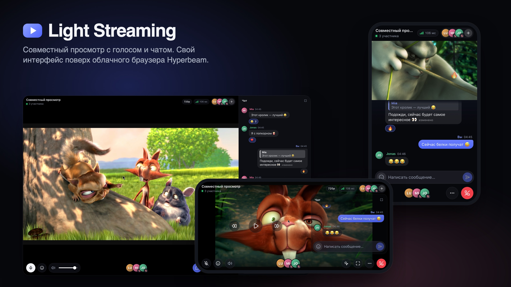

# Light Streaming

**Совместный просмотр с голосом и чатом, удобный с телефона.**
Свой интерфейс поверх облачного браузера [Hyperbeam](https://hyperbeam.com): видео идёт из облака прямо на каждое устройство,
а сервер живёт на ноутбуке ведущего ровно столько, сколько идёт просмотр.

`React 19` · `TypeScript` · `Node.js` · `WebSocket` · `WebRTC` · `Hyperbeam API` · `Cloudflare Quick Tunnel`

</div>

---

## Зачем это

Смотреть сериал вдвоём через видеозвонок неудобно, особенно с телефона: видео занимает треть экрана, плитки участников и панель кнопок съедают остальное, а чат открывается поверх всего и полностью закрывает картинку.

Light Streaming устроен наоборот: **видео — главное**. Остальное либо живёт в свободном месте экрана, либо полупрозрачное и прячется само.

- 🎬 **Облачный браузер.** Открываешь любой сайт, все видят одно и то же синхронно. Ноутбук ведущего ничего не кодирует и не раздаёт.
- 📱 **Интерфейс под телефон.** В вертикальном режиме чат под видео и ничего не перекрывает. В горизонтальном видео на весь экран, а чат — полупрозрачная панель.
- 🎙 **Голос.** P2P WebRTC между участниками, видео приглушается, когда кто-то говорит.
- 💬 **Чат как в Telegram.** Ответы, реакции, правка своих сообщений.
- 🔗 **Одна ссылка без домена.** Публичный HTTPS-адрес через Cloudflare Quick Tunnel, QR-код прямо в терминале.
- 🧹 **Ничего не висит.** Комната одна, пустая закрывается сама, облачная сессия всегда завершается.

## Как это выглядит

<table>
  <tr>
    <td width="33%" align="center">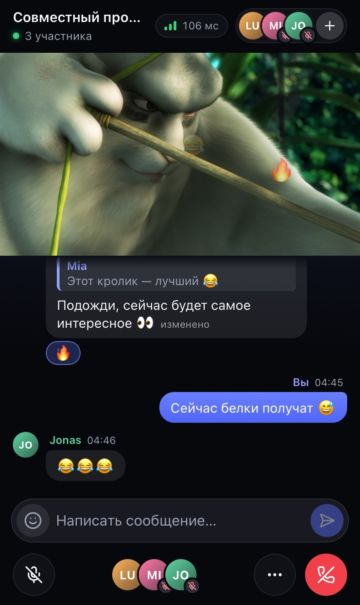<br><sub><b>Телефон вертикально.</b> Видео сверху во всю ширину, чат в свободном месте под ним.</sub></td>
    <td width="33%" align="center">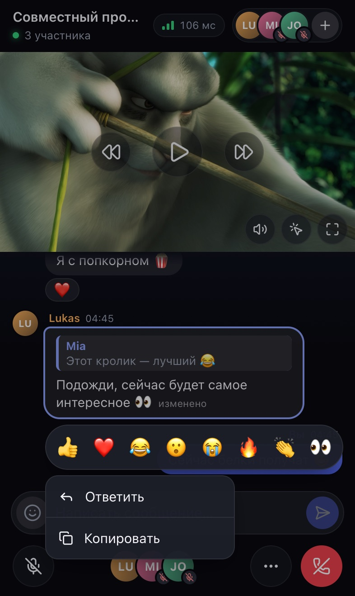<br><sub><b>Долгое нажатие на сообщение.</b> Реакции, «Ответить», «Изменить», «Копировать».</sub></td>
    <td width="33%" align="center">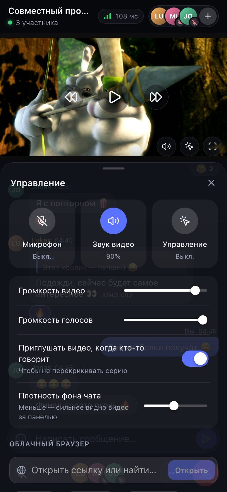<br><sub><b>Меню управления.</b> Шторка выезжает только до края видео: картинку видно всегда.</sub></td>
  </tr>
</table>

<table>
  <tr>
    <td width="50%" align="center">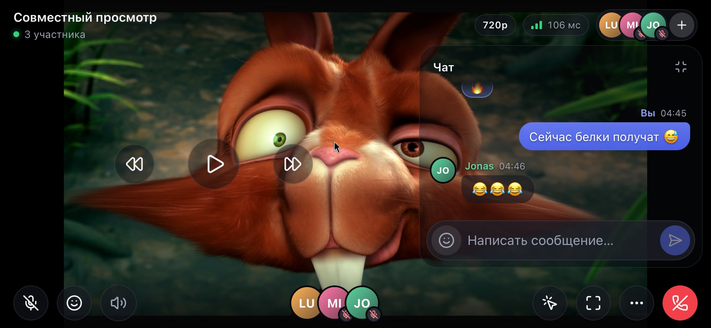<br><sub><b>Горизонтально с чатом.</b> Плотность фона панели регулируется: видео просвечивает.</sub></td>
    <td width="50%" align="center"><br><sub><b>Только видео.</b> Кнопки спрятались, новое сообщение всплыло на несколько секунд и не мешает нажатиям.</sub></td>
  </tr>
</table>

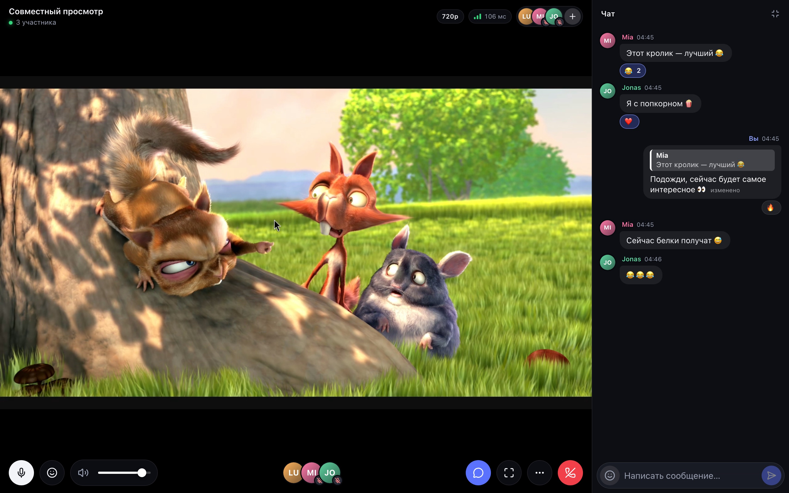
<p align="center"><sub><b>Компьютер.</b> Чат закреплён сбоку, панели стоят в чёрных полосах над и под видео, и сайт кликается целиком.</sub></p>

<table>
  <tr>
    <td width="50%" align="center">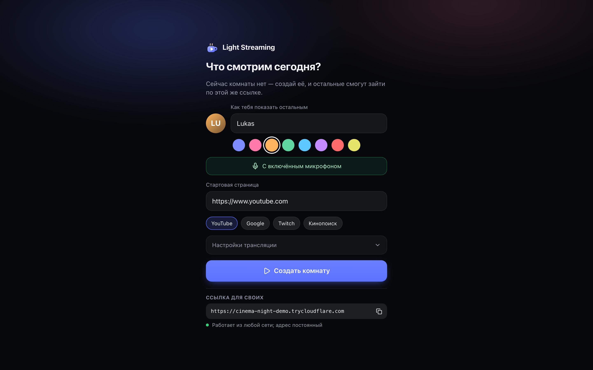<br><sub><b>Общая страница, комнаты нет.</b> Имя, что смотрим, настройки трансляции.</sub></td>
    <td width="25%" align="center">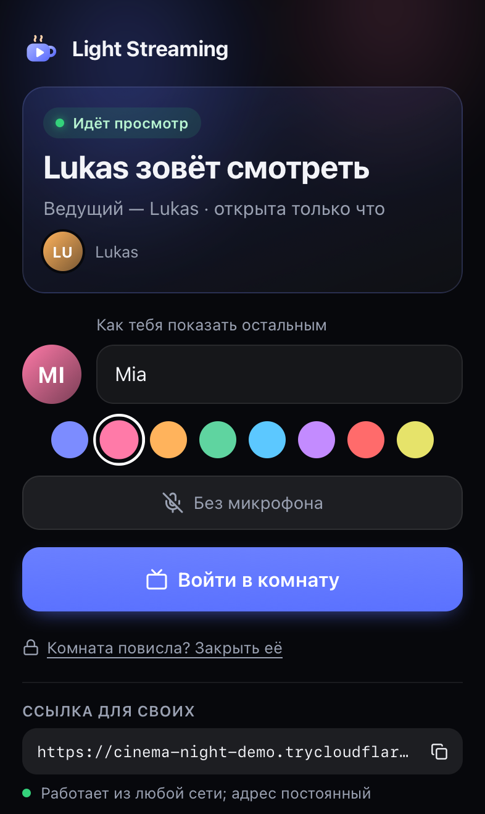<br><sub><b>Комната уже открыта.</b> Видно, кто ведущий и кто внутри.</sub></td>
    <td width="25%" align="center">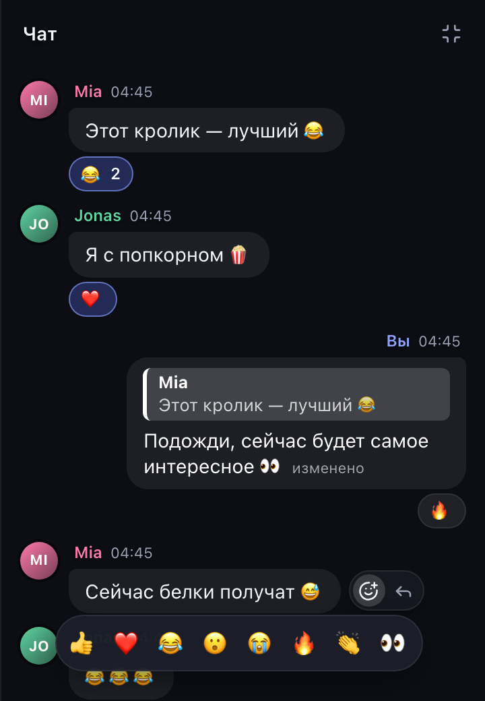<br><sub><b>На компьютере</b> действия появляются кружками при наведении.</sub></td>
  </tr>
  <tr>
    <td align="center">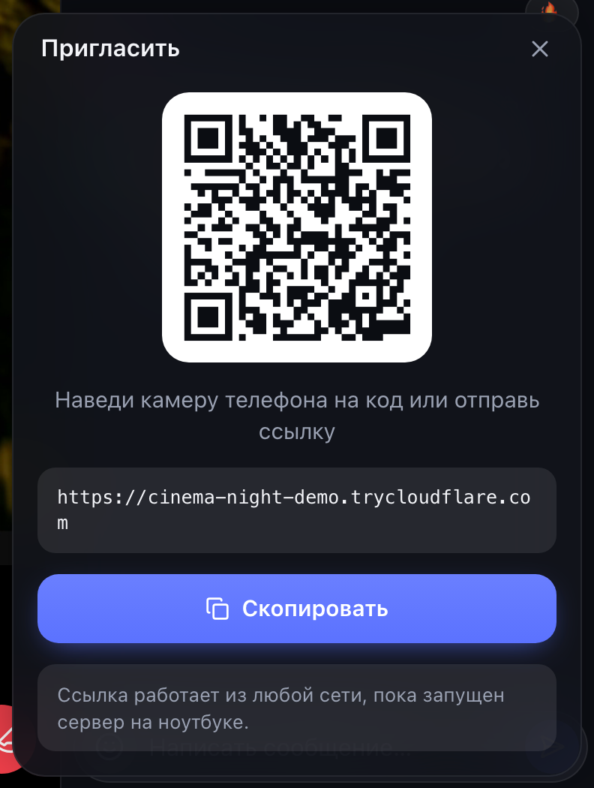<br><sub><b>Приглашение.</b> QR-код и публичная ссылка.</sub></td>
    <td colspan="2" align="center">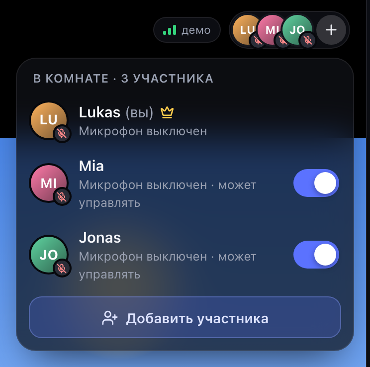<br><sub><b>Участники.</b> Ведущий раздаёт право управлять браузером.</sub></td>
  </tr>
</table>

---

## Быстрый старт

Нужны **Node.js 20+**, ключ [Hyperbeam API](https://hyperbeam.com) и, чтобы звать людей из любой сети, `cloudflared`.

```bash
git clone https://github.com/Ramazanm1nd3R/light-streaming.git
cd light-streaming
brew install cloudflared          # один раз, для публичной ссылки
cp .env.example .env              # вписать HYPERBEAM_API_KEY
npm install
npm run watch                     # сервер + туннель + QR-код в терминале, открывает страницу
```

`npm run watch` поднимает всё одной командой: сервер и туннель, печатает в терминале ссылку с QR-кодом и открывает общую страницу в браузере. Комнату создаёшь сам, кнопкой «Создать комнату». Ctrl+C закрывает облачную сессию, туннель и сервер.

| Команда | Что делает |
|---|---|
| `npm run watch` | Вечер просмотра одной командой: сборка, сервер, туннель, QR-код, страница в браузере |
| `npm start` | Сборка и сервер на `http://localhost:8787`, комнату создаёшь сам |
| `npm run dev` | Разработка: Vite с hot reload на `:5173` и сервер на `:8787` |
| `npm run typecheck` | Проверка типов |

> Без `HYPERBEAM_API_KEY` сервис стартует в **демо-режиме**: интерфейс, чат и голос работают, а вместо облачного браузера показывается заглушка. Удобно, чтобы попробовать интерфейс.

---

## Как это устроено

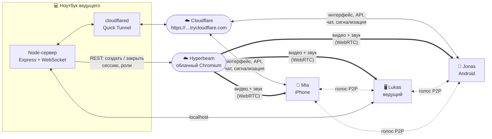

Важно, что **медиа не идёт через ноутбук**:

| Поток | Путь | Чем передаётся |
|---|---|---|
| Видео и звук сайта | Hyperbeam → каждый зритель напрямую | WebRTC, SDK `@hyperbeam/web` |
| Голос участников | Участник ↔ участник (mesh) | WebRTC P2P, сигнализация через наш WebSocket |
| Интерфейс, чат, реакции, состояние | Браузер ↔ сервер на ноутбуке | HTTPS + WebSocket через туннель |
| Создание и закрытие сессии, роли | Сервер → Hyperbeam REST API | Ключ API хранится только на сервере |

Поэтому слабый исходящий интернет ведущего на качество картинки не влияет: каждый получает поток из облака по своему соединению.

### Жизненный цикл комнаты

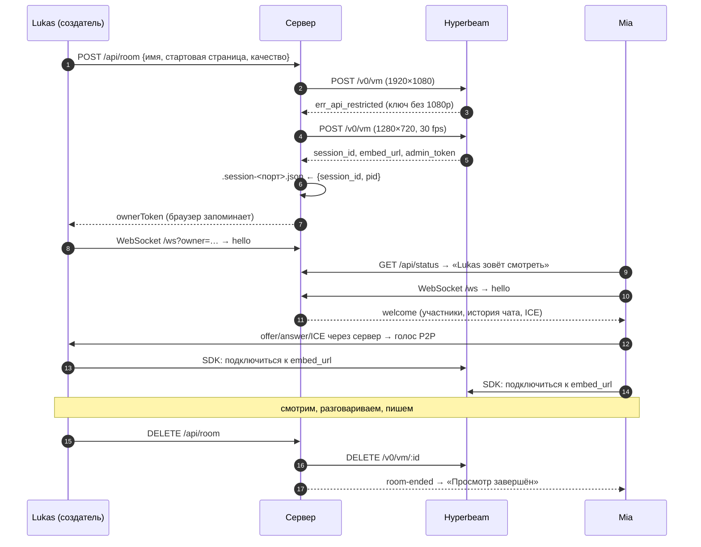

---

## Логика по частям

<details open>
<summary><b>🏠 Одна страница, одна комната, владелец и пароль</b></summary>

- **Общий адрес.** Знаешь ссылку — свой. Отдельных приглашений нет. Страница показывает либо форму «Создать комнату», либо карточку открытой комнаты с ведущим и списком участников.
- **Одна комната.** Пока комната открыта, `POST /api/room` отвечает `409`, так что вторую облачную сессию случайно не создать. Повторный клик по «Создать» защищён: пока первая создаётся, вторая не запускается.
- **Ведущий — тот, кто создал комнату.** Сервер выдаёт ему случайный `ownerToken`, браузер хранит его в `localStorage`. После вылета ведущий заходит снова и видит «Твоя комната открыта» → «Вернуться в комнату». Права ведущего восстановлены.
- **Пароль на закрытие.** Если ведущий вылетел и комната повисла, любой на общей странице или в шторке выхода закрывает её паролем `ROOM_PASSWORD` (по умолчанию `12345`). После 5 неверных попыток за 5 минут с одного адреса — `429`. Сравнение через `timingSafeEqual`.
- **Пустая комната закрывается сама** через `EMPTY_ROOM_TIMEOUT` секунд (по умолчанию 10 минут). Таймер запускается и сразу после создания, если создатель так и не вошёл.

</details>

<details>
<summary><b>☁️ Облачная сессия Hyperbeam: ничего не тратит впустую</b></summary>

- **Создание.** Сервер просит 1920×1080. Если ключ этого не позволяет (тестовые ключи отвечают `err_api_restricted` на 1080p и 60 fps), он автоматически повторяет запрос с 1280×720 и 30 fps. Фактическое качество показывается бейджем в шапке.
- **Параметры сессии.** `kiosk` (без интерфейса Chromium: адресную строку рисуем сами), тёмная тема, блокировщик рекламы, русская локаль, страховочные таймауты `offline` и `absolute`.
- **Сирота после сбоя.** ID сессии и PID процесса пишутся в `.session-<порт>.json`. Если ноутбук выключили, не закрыв комнату, при следующем старте сервер её закроет. Сессию **живого** процесса он не тронет никогда, а облачные сессии трогает только после того, как сам занял порт.
- **Hyperbeam закрыл сессию сам** (таймаут). Раз в 30 секунд сервер проверяет `termination_date` и, если сессия закончилась, закрывает комнату у всех.
- **Выход.** `DELETE /api/room`, Ctrl+C или SIGTERM → `DELETE /v0/vm/:id`.

</details>

<details>
<summary><b>🖱 Управление облачным браузером и права</b></summary>

- **Роли.** У Hyperbeam роли по умолчанию одни на всех. Если при создании выключено «Гости могут управлять», роль `control` пропадает и у ведущего. Поэтому сервер выдаёт её явно через `admin_token`: ведущему всегда, гостю — когда ведущий включил ему переключатель. Права восстанавливаются и после переподключения.
- **Компьютер.** Мышь и клавиатура уходят в облачный браузер всегда. Панели стоят в чёрных полосах над и под видео и не перекрывают сайт.
- **Телефон.** По умолчанию режим «Просмотр»: касания не попадают на сайт (`hb.disableInput`), чтобы случайно ничего не нажать. Кнопка с курсором включает «Управление».
- **Жесты.** Одно касание показывает или прячет кнопки, двойное слева или справа перематывает (← / →), по центру ставит паузу (пробел). Клавиши отправляются в облачный браузер через `hb.sendEvent`.
- **Пока набираешь сообщение**, клавиатура не печатает в облачный браузер (`hb.delegateKeyboard = false`).
- **Сторож потока.** Если за 12 секунд кадры не пошли, клиент сам переподключает медиасоединение, до трёх попыток. Потом показывает «Повторить».

</details>

<details>
<summary><b>🎙 Голос: P2P mesh на WebRTC</b></summary>

- **Без медиасервера.** Для 2–4 человек достаточно mesh: каждый соединён с каждым. Сигнализация (offer, answer, ICE) идёт через наш WebSocket, звук — напрямую.
- **Perfect negotiation.** Вежливая и невежливая стороны снимают гонки офферов. Новичок звонит всем, остальные отвечают.
- **Микрофон без пересогласования.** Один аудио-transceiver на пару, микрофон подставляется через `replaceTrack`. Выключенный микрофон останавливается полностью: на iPhone аудиосессия возвращается в режим воспроизведения, и звук видео снова звучит в полном качестве.
- **Голос важнее картинки.** `priority: high`, `networkPriority: high`, Opus до 48 кбит/с, эхо- и шумоподавление.
- **Смена сети.** При `disconnected` даётся 3 секунды на самовосстановление, при `failed` — сразу ICE restart. STUN Google и Cloudflare, TURN — по желанию (`TURN_*`).
- **«Говорит».** `AnalyserNode` меряет громкость, у говорящего зелёное кольцо вокруг аватара. Видео автоматически приглушается до 35%, пока кто-то говорит (отключается в меню).

</details>

<details>
<summary><b>💬 Чат как в Telegram</b></summary>

- **Ответ.** Цитата хранится снимком `{id, имя, текст}`: её видно, даже если оригинал ушёл из истории. Нажатие на цитату прокручивает к оригиналу и подсвечивает его.
- **Правка.** Только своих сообщений: сервер сверяет автора. Появляется пометка «изменено», и цитаты этого сообщения в ответах тоже обновляются.
- **Реакции.** 👍 ❤️ 😂 😮 😭 🔥 👏 👀, по одной от человека: та же снимается, другая заменяет.
- **Кто автор после переподключения.** У каждого браузера есть секретный ключ в `localStorage`. Сервер превращает его в публичный `uid = sha256(key)`. Свои сообщения можно править и после обрыва связи, а чужие — нельзя: ключ знает только его браузер.
- **Телефон.** Долгое нажатие открывает меню рядом с сообщением. «Клик», который браузер присылает при отпускании пальца, первые 500 мс игнорируется, чтобы меню не закрылось сразу.
- **Компьютер.** Кружки действий сбоку от пузыря, невидимый «мостик» над щелью, задержка перед скрытием. Правый клик открывает меню. ↑ в пустом поле начинает правку последнего своего сообщения, Esc отменяет.
- **Только на время просмотра.** История в памяти сервера (последние 200 сообщений), исчезает вместе с комнатой.

</details>

<details>
<summary><b>📐 Раскладки и полный экран</b></summary>

| Режим | Когда | Как устроено |
|---|---|---|
| `portrait` | телефон вертикально | Видео 16:9 сверху, чат в свободном месте, меню не выше края видео. При открытой клавиатуре нижняя панель прячется, высота считается по `visualViewport`. |
| `landscape` | телефон горизонтально или полный экран | Видео на весь экран. Шапка и кнопки — слои поверх, прячутся через 3,5 с и пропускают касания сквозь пустые места. |
| `desktop` | большой экран и мышь | Панели в чёрных полосах, чат закреплён сбоку, видео ужимается, а не перекрывается. |

- **Поворот без пересоздания.** Видео-сцена всегда в одном и том же DOM-контейнере, при повороте меняется только класс. Иначе Hyperbeam остался бы привязан к удалённому элементу.
- **Полный экран.** На Android, iPad и компьютере — Fullscreen API для всей страницы, без принудительного поворота. На iPhone Safari такого не позволяет, поэтому кнопка открывает `<video>` Hyperbeam в нативном плеере iOS (`webkitEnterFullscreen`): в любом положении, с «картинкой в картинке».
- Экран не гаснет во время просмотра (`Wake Lock API`).

</details>

<details>
<summary><b>🌍 Доступ из интернета: Cloudflare Quick Tunnel</b></summary>

- **Без домена и порт-форвардинга.** Сервер сам запускает `cloudflared tunnel --url http://localhost:8787`.
- **Готовность.** Адрес считается готовым только после строки `Registered tunnel connection`: до неё ссылка отдаёт ошибку.
- **Перезапуск.** Если `cloudflared` упал (сон ноутбука, смена сети), он поднимается заново с нарастающей паузой. Адрес при этом меняется: ведущий видит уведомление, новая ссылка с QR печатается в терминале.
- **Только для своих.** `TUNNEL_ALLOWED_EMAILS=friend@example.com` → Cloudflare попросит одноразовый код из письма.
- **Свой адрес.** `PUBLIC_URL=https://…` (named tunnel и т.п.) или `PUBLIC_URL=off`, если нужна только локальная сеть.
- **Безопаснее для iPhone.** По HTTPS-ссылке Safari надёжнее получает видео, чем по `http://` в локальной сети.

</details>

<details open>
<summary><b>🔒 Постоянная ссылка: Tailscale Funnel</b></summary>

Quick Tunnel даёт новый адрес при каждом запуске. Чтобы ссылка была всегда одной и той же (`https://macbook.tail1234.ts.net`), без домена и бесплатно, есть режим Tailscale Funnel. Гостям ничего ставить не нужно, им достаточно ссылки.

**Настройка, один раз:**

```bash
brew install tailscale                 # на Mac Funnel работает только с этим вариантом,
sudo brew services start tailscale     # а не с приложением из App Store или с сайта
tailscale up                           # вход в аккаунт Tailscale в браузере
```

Затем в `.env` поставь `PUBLIC_URL=tailscale` и запусти `npm run watch`. При первом запуске Tailscale попросит разрешить Funnel для этой машины: ссылка появится в терминале и на общей странице. После этого адрес не меняется.

**Как это работает:**
- Сервер берёт имя машины из `tailscale status --json` и, пока работает, держит запущенным `tailscale funnel <порт>`. В этом режиме Funnel сам выключается, когда сервер завершается, и ничего не остаётся открытым.
- Если Tailscale не установлен, не запущен, не выполнен вход или Funnel ещё не разрешён, терминал и общая страница показывают, что именно сделать.
- Если Funnel упал, он перезапускается, а ссылка остаётся прежней.
- В первые минуты после включения публичный DNS нового адреса может ещё расходиться (до ~10 минут).

</details>

### Протокол WebSocket

<details>
<summary>Сообщения клиента и сервера</summary>

| Клиент → сервер | Назначение |
|---|---|
| `hello {name, color, micOn, key}` | Войти в комнату, `key` — секрет браузера для `uid` |
| `chat {text, replyTo?}` / `edit {id, text}` / `react {id, emoji}` | Сообщения, правка, реакции |
| `reaction {emoji}` | Летящая реакция поверх видео |
| `mic {on}` · `hb-user {hbUserId}` · `set-control {participantId, canControl}` | Микрофон, связь с Hyperbeam, права |
| `signal {to, data}` | Сигнализация WebRTC для голоса |
| `ping {at}` | Измерение задержки |

| Сервер → клиент | Назначение |
|---|---|
| `welcome {selfId, selfUid, participants, history, ice}` | Состояние при входе |
| `joined` / `left` / `updated` | Участники |
| `chat` / `chat-update` | Новое сообщение / правка или реакции |
| `reaction` · `signal` · `pong` · `error` | Реакции, WebRTC, задержка, ошибки |
| `room-ended {reason}` | Комната закрыта: ведущим, паролем, таймаутом или Hyperbeam |

</details>

---

## Настройки (`.env`)

| Переменная | По умолчанию | Описание |
|---|---|---|
| `HYPERBEAM_API_KEY` | — | Ключ Hyperbeam. Пусто — демо-режим |
| `PORT` | `8787` | Порт сервера |
| `PUBLIC_URL` | `auto` | `auto` — Quick Tunnel (адрес новый при каждом запуске), `tailscale` — Tailscale Funnel (адрес постоянный), `off` — только локальная сеть, `https://…` — свой адрес |
| `TUNNEL_ALLOWED_EMAILS` | — | Пускать по ссылке только эти email (код из письма от Cloudflare, только для `auto`) |
| `ROOM_PASSWORD` | `12345` | Пароль, которым любой может закрыть повисшую комнату |
| `EMPTY_ROOM_TIMEOUT` | `600` | Через сколько секунд закрывается пустая комната |
| `HYPERBEAM_REGION` | `EU` | Регион облачного браузера: `NA`, `EU`, `AS` |
| `HB_OFFLINE_TIMEOUT` / `HB_ABSOLUTE_TIMEOUT` | `600` / `21600` | Страховочные таймауты облачной сессии (секунды) |
| `TURN_URLS`, `TURN_USERNAME`, `TURN_CREDENTIAL` | — | TURN-сервер для голоса в строгих сетях |

Секреты (`.env`) и служебные файлы сессий (`.session-*.json`) в репозиторий не попадают: они в `.gitignore`. Ключ Hyperbeam живёт только на сервере. `admin_token` облачной сессии получает только браузер ведущего: SDK он нужен для раздачи прав и навигации.

---

## Структура проекта

```
server/
  index.ts        API, раздача фронтенда, терминал с QR, запуск и корректное завершение
  room.ts         одна комната: владелец, пароль, автозакрытие, сироты, слежение за Hyperbeam
  realtime.ts     WebSocket-хаб: участники, чат (ответы, правка, реакции), роли, сигнализация
  hyperbeam.ts    REST-клиент Hyperbeam: сессии с откатом на 720p, роли, проверка завершения
  tunnel.ts       туннели: Cloudflare Quick Tunnel и Tailscale Funnel, готовность, перезапуск
  config.ts       настройки из .env
shared/
  protocol.ts     общие типы клиента и сервера
src/
  App.tsx                     фазы: общая страница → комната → «просмотр завершён»
  components/Screens.tsx      общая страница: создать / войти / закрыть паролем
  components/Room.tsx         комната и три раскладки
  components/Stage.tsx        видео 16:9, жесты, летящие реакции, статус потока
  components/Chat.tsx         лента, меню сообщения, поле ввода с ответом и правкой
  components/Sheets.tsx       шторки: управление, участники, приглашение, выход
  hooks/useHyperbeam.ts       встраивание облачного браузера и сторож потока
  hooks/useRoomSession.ts     WebSocket и голос, состояние комнаты
  lib/voice.ts                WebRTC mesh: perfect negotiation, replaceTrack, ICE restart
  lib/realtime.ts             WebSocket с переподключением
  lib/fullscreen.ts           полный экран для всех браузеров и нативный плеер iOS
docs/screenshots/             картинки для этого README
```

---

## Ограничения

- **Тестовый ключ Hyperbeam** не даёт 1080p и 60 fps: сервер сам переключается на 720p/30. Расширенный доступ выдаёт Hyperbeam (founders@hyperbeam.com).
- **iPhone и микрофон.** Пока микрофон включён, iOS переводит звук в режим звонка, и громкость видео немного падает. Выключенный микрофон или наушники это решают.
- **Полный экран на iPhone** — нативный плеер. В нём только просмотр: чтобы кликать по сайту и видеть чат, нужно выйти из полного экрана. Весь интерфейс без панелей Safari даёт «Поделиться → На экран Домой».
- **Громкость голосов на iOS** меняется только кнопками телефона: Safari не позволяет задавать громкость `<audio>`.
- **Quick Tunnel** даёт новый адрес при каждом запуске и предназначен для личного использования, без гарантий доступности. Для постоянной ссылки есть режим Tailscale Funnel.
- **Клавиши плеера** (пробел, ←/→, F) работают на большинстве сайтов, но конкретный плеер может их не поддерживать.
- **DRM-контент** может не отображаться в облачном браузере.

---

## Благодарности

- Кадры на скриншотах — из **[Big Buck Bunny](https://peach.blender.org/)** © Blender Foundation, лицензия [CC BY 3.0](https://creativecommons.org/licenses/by/3.0/). Имена участников вымышлены.
- Облачный браузер — **[Hyperbeam](https://hyperbeam.com)**, иконки — **[Lucide](https://lucide.dev)**.
